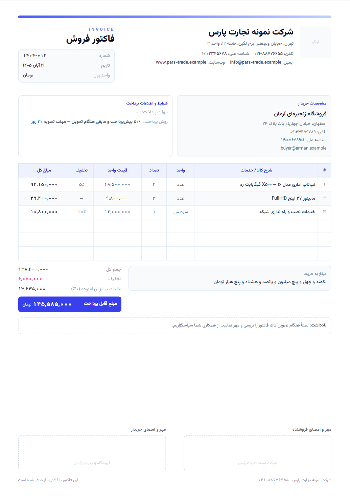

# فاکتورساز — ساخت فاکتور فروش با خروجی PDF و Word

یک وب‌اپلیکیشن ساده و کامل با **Next.js** برای صدور فاکتور فروش؛ کاملاً فارسی و راست‌به‌چپ، بدون نیاز به بک‌اند و دیتابیس.



## امکانات

- **ویزارد چهار مرحله‌ای**، دقیقاً مطابق روند خواسته‌شده:
  1. اطلاعات اولیه: لوگو، نام و مشخصات شرکت، اطلاعات خریدار، شماره/تاریخ فاکتور و تنظیمات مالیات
  2. اقلام فروش: شرح کالا، واحد، تعداد، قیمت واحد و درصد تخفیف برای هر ردیف
  3. متن پایانی: یادداشت پایین فاکتور، شرایط پرداخت و جای امضای فروشنده/خریدار
  4. خروجی: پیش‌نمایش A4 و دانلود PDF / Word
- **لوگو** با انتخاب فایل یا کشیدن و رها کردن (PNG، JPG، WEBP، SVG)؛ تصویر به‌صورت خودکار بهینه‌سازی و داخل فایل‌ها جاسازی می‌شود.
- **محاسبات خودکار**: جمع هر ردیف، جمع کل، تخفیف، مالیات بر ارزش افزوده و مبلغ نهایی + **مبلغ به حروف فارسی**.
- **خروجی PDF** در ابعاد A4 با کیفیت چاپ (تصویر ۳ برابر) و فونت فارسی دقیقاً مثل پیش‌نمایش.
- **خروجی Word (.docx)** راست‌به‌چپ با جدول‌های قابل ویرایش، لوگو و جای امضا.
- **چاپ مستقیم** با دکمه «چاپ فاکتور» یا `Ctrl + P` (استایل چاپ مخصوص A4 تعریف شده است).
- **ذخیره خودکار پیش‌نویس** در `localStorage`؛ با بستن مرورگر اطلاعات از دست نمی‌رود.
- دکمه «نمونه» برای پر کردن سریع فرم با داده آزمایشی و دکمه «پاک کردن» برای شروع از صفر.
- رابط کاربری واکنش‌گرا (موبایل و دسکتاپ) با فونت **وزیرمتن**، بدون وابستگی به CDN.

## اجرا

پیش‌نیاز: Node.js 18.18 یا بالاتر.

```bash
npm install
npm run dev
```

سپس آدرس [http://localhost:3000](http://localhost:3000) را باز کنید.

برای نسخه‌ی production:

```bash
npm run build
npm start
```

## ساختار پروژه

```
app/
  layout.tsx          چیدمان راست‌به‌چپ، فونت و متادیتا
  page.tsx            وضعیت فاکتور، مراحل و ذخیره خودکار
  globals.css         استایل فرم‌ها، برگه A4 و قواعد چاپ
components/
  InvoiceSheet.tsx    برگه فاکتور (منبع اصلی ظاهر PDF و چاپ)
  SheetPreview.tsx    مقیاس‌دهی پیش‌نمایش A4
  Stepper.tsx         نشانگر مراحل
  ui.tsx              فیلدها، ورودی عددی/مبلغ، سوییچ و کارت‌ها
  steps/              چهار مرحله ویزارد
lib/
  invoice.ts          مدل داده، محاسبات و داده نمونه
  format.ts           اعداد فارسی، تاریخ شمسی و تبدیل عدد به حروف
  export-pdf.ts       ساخت PDF با html-to-image + jsPDF
  export-docx.ts      ساخت Word با کتابخانه docx
  logo.ts             خواندن، بهینه‌سازی و تبدیل لوگو
  storage.ts          ذخیره/بازیابی پیش‌نویس در مرورگر
docs/preview.png      تصویر پیش‌نمایش
```

## نکات فنی

- **PDF**: برگه‌ی پیش‌نمایش با `html-to-image` (و جاسازی فونت) به تصویر ۳ برابری تبدیل و با `jsPDF` روی صفحه A4 نشانده می‌شود. اگر تعداد اقلام از یک صفحه بیشتر شود، خروجی به‌صورت خودکار چندصفحه‌ای می‌شود.
- **Word**: سند با کتابخانه `docx` ساخته می‌شود؛ جهت جدول‌ها و پاراگراف‌ها RTL است، فونت Tahoma انتخاب شده تا در ویندوز بدون مشکل باز شود و لوگو به‌صورت تصویر داخل فایل قرار می‌گیرد.
- **حریم خصوصی**: هیچ داده‌ای به سرور ارسال نمی‌شود؛ همه‌چیز در مرورگر کاربر پردازش و ذخیره می‌شود.
- برای چاپ، در پنجره‌ی چاپ اندازه کاغذ را **A4** و حاشیه را **هیچ (None)** انتخاب کنید.

## سفارشی‌سازی

| چه چیزی | کجا |
| --- | --- |
| رنگ برند | `tailwind.config.ts` (بخش `colors.brand`) |
| واحد پول | `lib/invoice.ts` (آرایه `CURRENCIES`) |
| واحدهای پیشنهادی کالا | `lib/invoice.ts` (آرایه `UNITS`) |
| ستون‌های جدول اقلام | `components/InvoiceSheet.tsx` و `lib/export-docx.ts` |
| متن پیش‌فرض یادداشت و امضا | `lib/invoice.ts` (`createEmptyData`) |

## مجوز

این پروژه برای استفاده آزاد در اختیار شماست.
